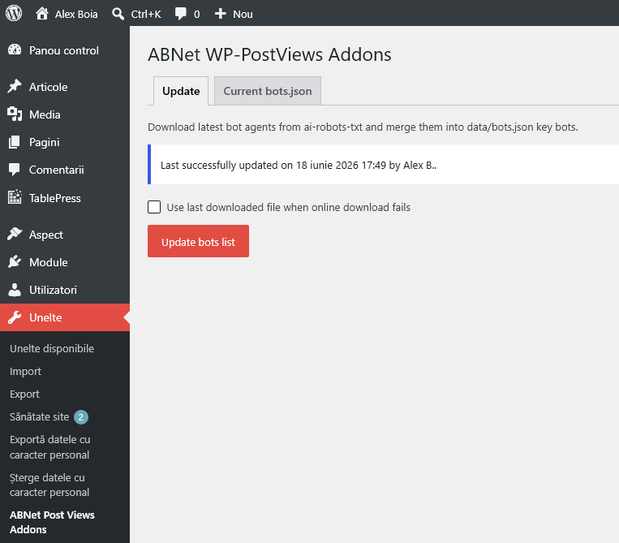
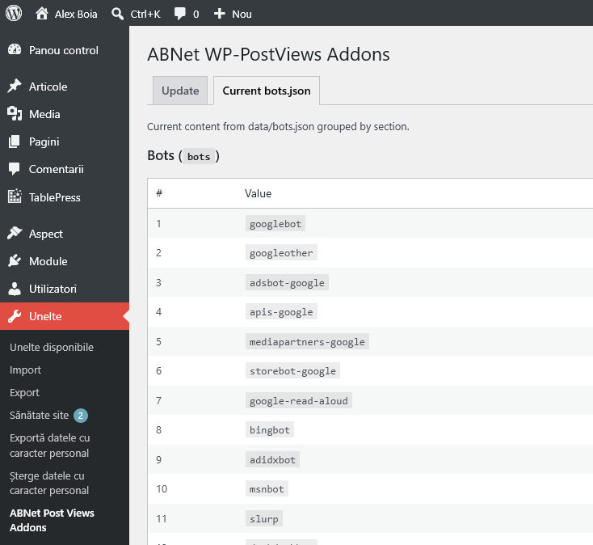

<h1 align="center">ABNet WP-PostViews Addons</h1>

<p align="center">
   A lightweight extension for WP-PostViews that blocks view counting for known bots and social/embed traffic,
   based on rules from data/bots.json and optional strict referer-domain matching.
</p>

## Features

- Extends [WP-PostViews](https://github.com/lesterchan/wp-postviews) through its native `postviews_should_count` filter;
- Blocks view count for requests by User-Agent patterns from `data/bots.json` (`bots` section);
- Blocks view count for requests by Referer patterns from `data/bots.json` (`referers` section);
- Supports strict referer-domain matching (exact domain or subdomain only);
- Includes a Tools page for updating the local bots list from [ai-robots-txt](https://github.com/ai-robots-txt/ai.robots.txt);
- Supports fallback to the last downloaded source when remote download fails;
- Includes a tab that previews current `bots.json` sections in admin.

## How It Works

The plugin hooks into `postviews_should_count` and returns `false` for requests that match:

- bot User-Agent patterns;
- referer patterns.

In strict mode, referer checks are host/domain-aware instead of simple substring checks.

## Requirements

- WordPress 6.x;
- PHP 8.0+;
- WP-PostViews plugin active;
- PHP cURL extension recommended for downloading bots updates.

## Install

1. Copy the plugin folder to `wp-content/plugins/abnet-wp-post-views-addons`.
2. Activate the plugin from WordPress Admin.
3. Ensure WP-PostViews is active and configured.
4. (Optional) Go to Tools > ABNet Post Views Addons to update bots data.

## Configurable Constants

Define constants in `wp-config.php` before WordPress loads plugins.

| Constant | Type | Default | Purpose |
|----------|------|---------|---------|
| `ABNET_WP_POST_VIEWS_STRICT` | bool | `false` (when undefined) | Enables strict referer host matching (`example.com` and `*.example.com`). |
| `ABNET_WP_POST_VIEWS_TRACKING_ENABLED` | bool | `true` (when undefined) | Enables storing tracked visit metadata. Set to `false` to keep bot exclusion behavior without saving visit rows. |
| `ABNET_WP_POST_VIEWS_FUZZY_BOT_SCORE_THRESHOLD` | int | `65` (when undefined, non-int, or `<= 0`) | Minimum fuzzy bot score that auto-flags a request as bot after score calculation. |
| `ABNET_WP_POST_VIEWS_AI_ROBOTS_TXT_URL` | string | `https://raw.githubusercontent.com/ai-robots-txt/ai.robots.txt/main/robots.json` | Overrides the source URL used by the updater. |

### Example

```php
define('ABNET_WP_POST_VIEWS_STRICT', true);
define('ABNET_WP_POST_VIEWS_TRACKING_ENABLED', true);
define('ABNET_WP_POST_VIEWS_FUZZY_BOT_SCORE_THRESHOLD', 65);
define('ABNET_WP_POST_VIEWS_AI_ROBOTS_TXT_URL', 'https://raw.githubusercontent.com/ai-robots-txt/ai.robots.txt/main/robots.json');
```

## Plugin Filters

### `abnet_wpv_addons_bot_patterns`

Filters bot User-Agent patterns loaded from `bots.json`.

- Input: `string[] $defaultBotPatterns`
- Output: `string[]`

```php
add_filter('abnet_wpv_addons_bot_patterns', function(array $patterns): array {
	$patterns[] = 'MyCustomCrawler';
	return array_values(array_unique($patterns));
});
```

### `abnet_wpv_addons_referer_patterns`

Filters referer patterns loaded from `bots.json`.

- Input: `string[] $defaultPatterns`
- Output: `string[]`

```php
add_filter('abnet_wpv_addons_referer_patterns', function(array $patterns): array {
	$patterns[] = 'my-embed-host.example';
	return array_values(array_unique($patterns));
});
```

### `abnet_wpv_addons_normalized_domain`

Filters a normalized referer domain before strict matching. A null return value will cause the domain to be skipped altogether.

- Input: `string $normalizedDomain`
- Output: `string|null`

```php
add_filter('abnet_wpv_addons_normalized_domain', function(string $domain): string {
	return trim(strtolower($domain));
});
```

### `abnet_wpv_addons_last_update_message`

Filters the info message shown on the Tools page after successful updates.

- Input:
  - `string $lastUpdateMessage`
  - `string $userDisplayName`
  - `string $formattedDate`
- Output: `string`

```php
add_filter('abnet_wpv_addons_last_update_message', function(
	string $message,
	string $user,
	string $date
): string {
	return sprintf('Bots list was last refreshed on %s by %s.', $date, $user);
}, 10, 3);
```

### `abnet_wpv_addons_fuzzy_bot_score`

Filters the computed bot probability score saved with each tracked visit.

- Input:
  - `ABNetWpPostViewsAddons\FuzzyBotScore $score`
  - `ABNetWpPostViewsAddons\VisitInfo $visitInfo`
- Output: `ABNetWpPostViewsAddons\FuzzyBotScore`

```php
add_filter('abnet_wpv_addons_fuzzy_bot_score', function(
	ABNetWpPostViewsAddons\FuzzyBotScore $score,
	ABNetWpPostViewsAddons\VisitInfo $visitInfo
): ABNetWpPostViewsAddons\FuzzyBotScore {
	if ($visitInfo->getCfIpCountry() === 'RO') {
		return new ABNetWpPostViewsAddons\FuzzyBotScore(
			$score->getScore() - 5,
			$score->getSignals()
		);
	}

	return $score;
}, 10, 2);
```

## Fuzzy Bot Score

Tracked visits include a `fuzzy_bot_score` value from `0` to `100`, estimating how likely the request is to be automated after deterministic `bots.json` matching has already happened. The calculator returns a `FuzzyBotScore` object containing both the normalized score and the contributing signal map.

The fuzzy score is based only on `VisitInfo` fields, not on the already-computed bot/referer matching flags. It uses softer request-shape signals such as user-agent structure, missing or weak `Accept`, missing `Accept-Language`, suspicious network names, unusual request methods, no cookies, protocol hints, referer shape, search terms, and UTM parameters. Normal browser signals, local referers, search referers, HTTP/2 or HTTP/3, rich browser `Accept` headers, and campaign-tagged visits can reduce the score slightly.

Current signals include:

- suspicious or missing User-Agent values, including malformed Safari-like strings, old Chrome versions, and abandoned Windows desktop masks;
- missing, wildcard, or non-HTML `Accept` headers;
- missing `Accept-Language`;
- request methods other than `GET` or `HEAD`;
- protocol hints such as `HTTP/1.0`, `HTTP/2`, and `HTTP/3`;
- missing, local, or search referers;
- missing cookies;
- search and UTM campaign hints;
- invalid Cloudflare country metadata and suspicious hosting/cloud network names.

## `bots.json` Structure

The plugin reads `data/bots.json`. Typical structure:

```json
{
	"bots": [
		"Googlebot",
		"bingbot",
		"facebookexternalhit"
	],
	"referers": [
		"facebook.com",
		"l.facebook.com",
		"t.co",
		"linkedin.com"
	]
}
```

## Tools Page

Under `Tools` > `ABNet Post Views Addons`:

- `Update` tab:
  - downloads latest source and merges only the `bots` section;
  - can use last downloaded file as fallback.

- `Current bots.json` tab:
  - displays all current sections and values from local `data/bots.json`.

## Screenshots

### Tools - Update tab


### Tools - Current bots tab


## Support Script (`support/test.php`)

This repository also contains a CLI helper script for manual traffic simulation and diagnostics.

Note: this script is for development/support workflows and is not distributed with the plugin package.

Usage:

```bash
php test.php <url> [--limit=NUMBER] [--auto-batch] [--no-delay] [--legit-requests]
```

Parameters:

- `<url>`: Required. Full target URL (example: `https://example.com/article`).
- `--limit=NUMBER`: Optional. Maximum number of scenarios to run from the beginning. Use `0` (default) to run all scenarios from `bots.json`.
- `--auto-batch`: Optional. Skips confirmation prompt between batches.
- `--no-delay`: Optional. Disables random delay (1-2s) between requests.
- `--legit-requests`: Optional. Emits legitimate-looking browser requests with random normal/search referers, required `Accept` and `Accept-Language` headers, and optional Cloudflare country/AS headers. If no positive `--limit` is provided, 50 requests are sent.

Examples:

```bash
php test.php "https://example.com/article" --limit=25
php test.php "https://example.com/article" --auto-batch --no-delay
php test.php "https://example.com/article" --legit-requests --limit=50
```


## Notes

- The plugin respects WP-PostViews native "Exclude Bot Views" setting.
- If `WP_DEBUG` is enabled, diagnostic logs may be written using `error_log`.

## Version History

| Version | Changes |
|---------|---------|
| `1.0.0` | Initial release with bot/referer filtering, strict mode, updater, and Tools integration. |
